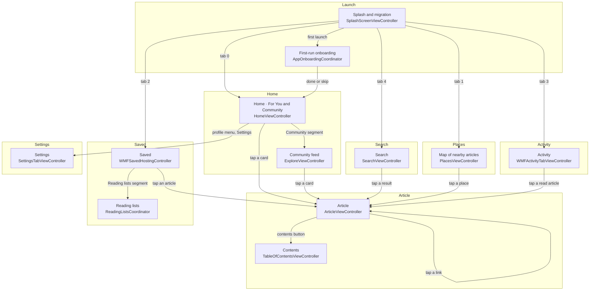
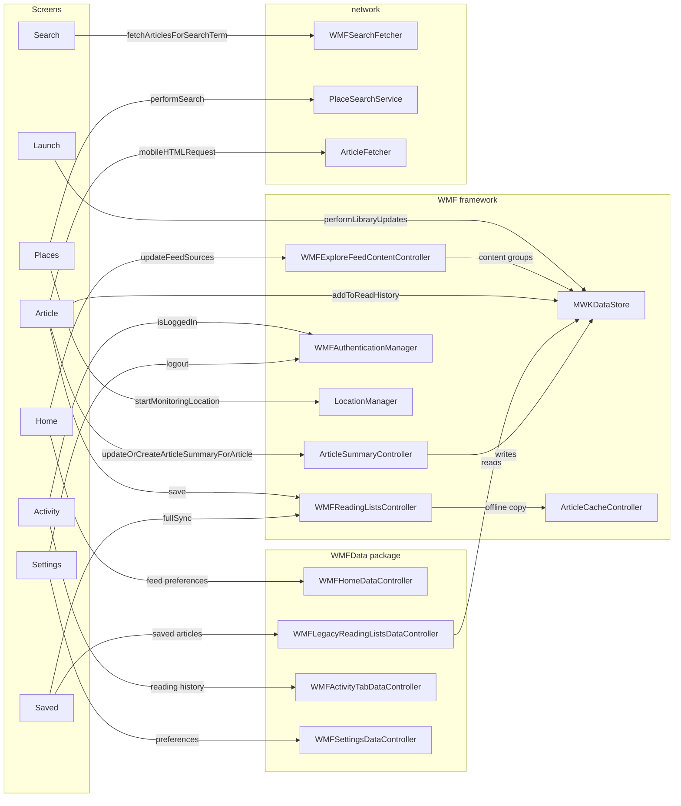

## Screens · how the user moves

`SceneDelegate` hands the window to `WMFAppViewController`, a `UITabBarController` that shows a splash while the Core Data store migrates, presents the first-run onboarding once, and then builds five tabs — Home, Places, Saved, Activity, Search — each in its own navigation controller. Articles push onto whichever tab you are in; Settings opens from the profile menu behind the account button in every tab's navigation bar. After 24 hours in the background the app reopens on Home.

- `───▷` opens
- `▭` tap to open its module

## Services · what the screens share

One `MWKDataStore` (Core Data, owned by the app controller) holds articles, history, saved pages, feed groups and reading lists; the older screens read it directly, while the newer SwiftUI screens go through data controllers in the `WMFData` package. Article pages are rendered HTML from the Page Content Service, cached for offline reading.

- `───▷` calls, labelled with the method or what it reads
- `▭` tap to open its module
