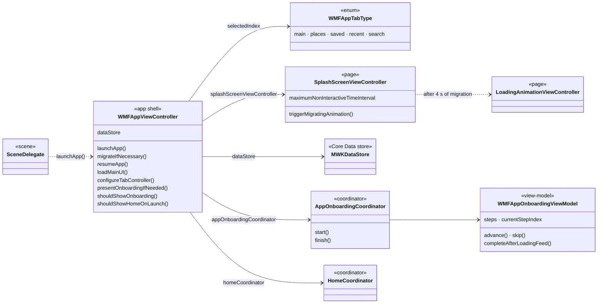
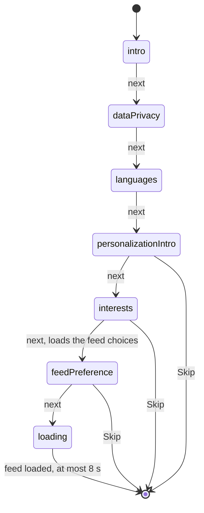
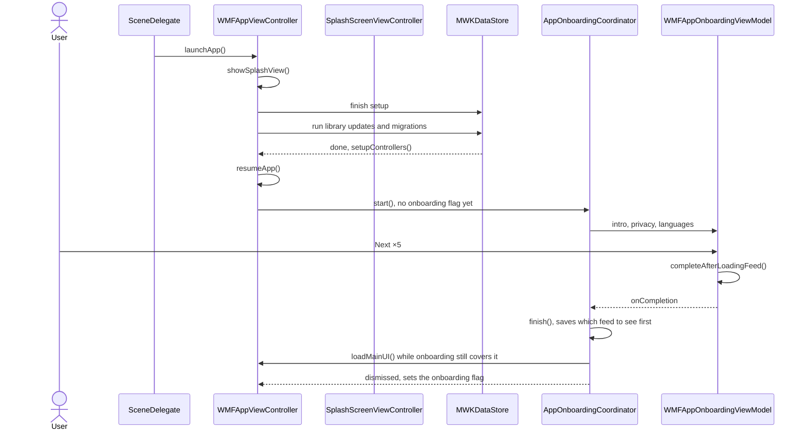

## What it does {#what}

`SceneDelegate` creates the window and calls `launchApp(in:waitToResumeApp:)` on the single `WMFAppViewController`. It covers itself with `SplashScreenViewController` (the launch-screen wordmark), then waits for `MWKDataStore` to finish its Core Data setup and library updates; if a migration is needed and takes longer than 4 s, the splash cross-fades over 0.3 s into a loading animation. When the data is ready, `setupControllers()` starts the background workers and `resumeApp` decides what to show. On the very first launch (no `WMFDidShowOnboarding` flag, and not opened from a link that skips it) `AppOnboardingCoordinator` presents a SwiftUI flow of seven steps: intro, data & privacy, languages (the device's languages, with an editor), a personalization intro, interests, feed preference (which Home segment to see first), and a loading step that builds the Home feed — it waits for the feed for at most 8 s and shows the animation for at least one 1 s loop. The last three steps show page dots and **Skip**, which keeps the default feed preference. Whatever path it takes, the app then builds five tabs — Home, Places, Saved, Activity, Search — each in its own navigation controller, and reopens on Home if it was in the background for 24 hours or more (unless the reader chose to open on Search).

## Logic · class diagram {#classes}

The tab bar controller is also the app coordinator: it owns the data store, the splash, the onboarding and the tab roots.

- `──▷` holds
- `┄┄▷` uses · opens

## Onboarding · state machine {#states}

`advance()` moves one step; `skip()` (shown on the personalization steps) and the end of loading both finish.

## First launch · sequence {#sequence}

The splash stays up until the store is ready; onboarding replaces it, and the tabs load behind it.

## Key files {#files}

- `Wikipedia/Code/SceneDelegate.swift` · window, URLs, user activities
- `Wikipedia/Code/WMFAppViewController.swift` · tab bar, launch, resume, routing
- `Wikipedia/Code/SplashScreenViewController.swift` · splash and migration animation
- `Wikipedia/Code/AppOnboardingCoordinator.swift` · first-run onboarding
- `WMFComponents/Sources/WMFComponents/Components/App Onboarding/` · onboarding views and steps
- `Wikipedia/Code/MWKDataStore.m` · Core Data store setup and migration
