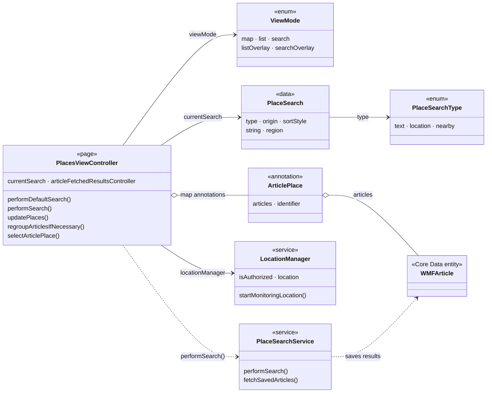
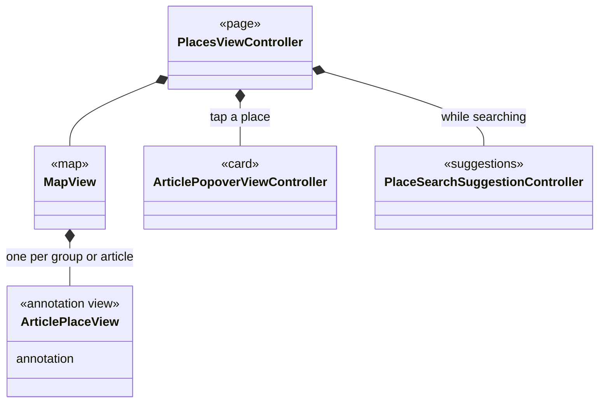
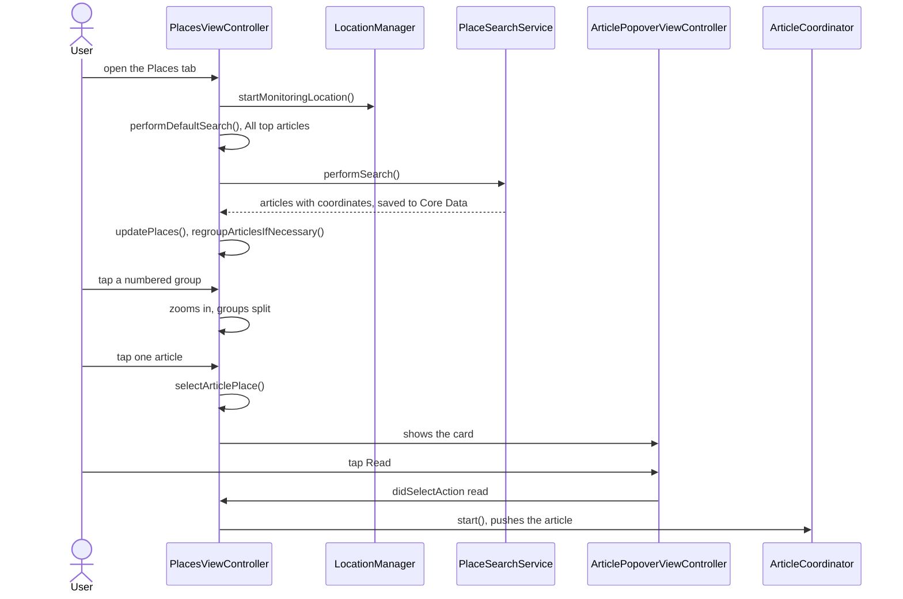

## What it does {#what}

`PlacesViewController` shows an `MKMapView` of articles with coordinates. Without a query it runs the default search — **All top articles** in the visible region — and a search bar on top accepts a place name or a topic, with suggestions and recent place searches. `PlaceSearchService` turns a search into geosearch results from the wiki (or a fetch of saved articles with a location), and the results become `WMFArticle` rows in Core Data that a fetched-results controller watches. On the map the articles are grouped by quad key: the grouping precision follows the zoom, 4 levels finer than the visible span (capped at 17), and a group of 3 or more articles becomes one numbered `ArticlePlace` annotation that zooms in when tapped. Tapping a single article shows a popover card with its description, distance and bearing, save and share buttons, and opening it pushes the article. When you pan far enough from the last search, a **Redo search** button appears. A toggle switches to a list sorted by distance, and the user's location (if allowed) centres the map and orders the list.

## Logic · class diagram {#classes}

Searches write into Core Data; the map and list both read the same fetched results and regroup on every region change.

- `──▷` holds
- `◇──` list of
- `┄┄▷` uses

## Screen · view composition {#widgets}

- `◆──` contains

## Open the map and an article · sequence {#sequence}

The default search runs as soon as the map has a region; regrouping follows every pan and zoom.

## Key files {#files}

- `Wikipedia/Code/PlacesViewController.swift` · map, list, search, grouping
- `Wikipedia/Code/PlaceSearchService.swift` · geosearch and saved places
- `Wikipedia/Code/PlaceSearch.swift` · search kinds and origins
- `Wikipedia/Code/ArticlePlace.swift` · map annotation for one or more articles
- `Wikipedia/Code/ArticlePlaceView.swift` · annotation view
- `Wikipedia/Code/ArticlePopoverViewController.swift` · article card on the map
- `Wikipedia/Code/QuadKey.swift` · grouping by quad key
- `WMF Framework/LocationManager.swift` · location updates
