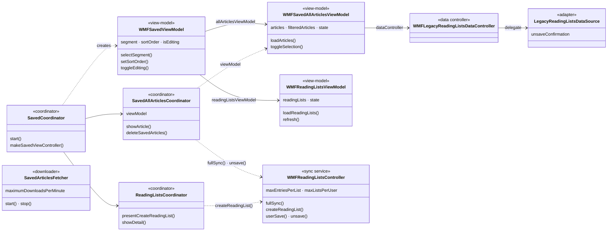
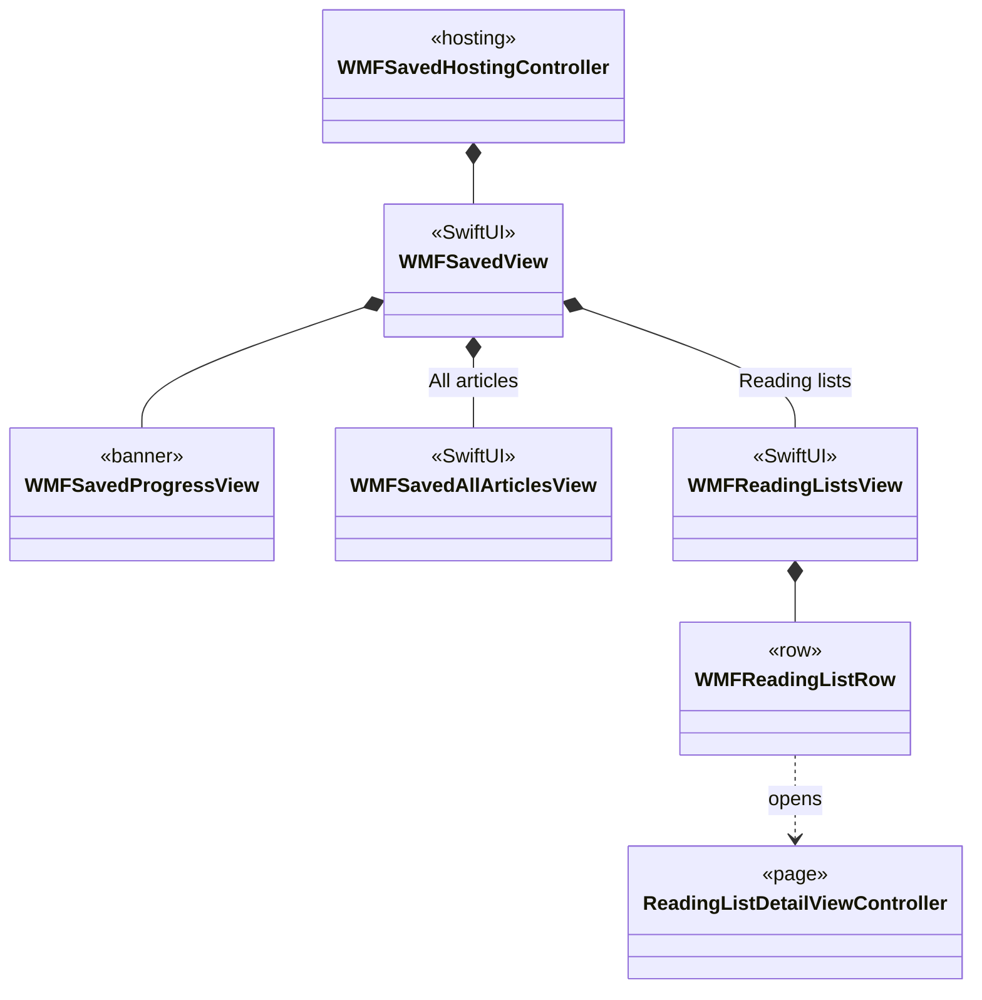
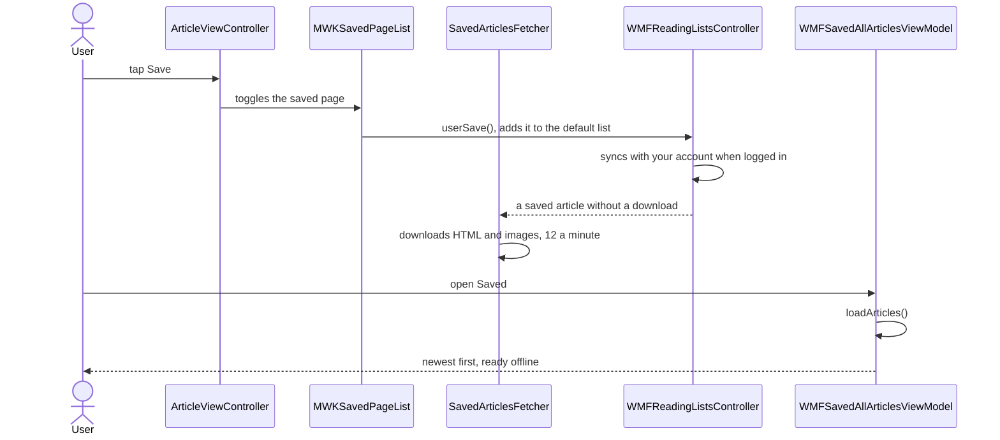

## What it does {#what}

`SavedCoordinator` builds the Saved tab as one SwiftUI screen, `WMFSavedHostingController`, with two segments: **All articles** and **Reading lists**. Saving an article anywhere (the article toolbar, a feed card, a map popover) toggles it in `MWKSavedPageList`; `SavedArticlesFetcher` then downloads each saved article with its images for offline reading, at most 12 downloads a minute, and backs off when the server answers busy. All articles lists them newest first or by title, with search, a download-progress banner, an edit mode to select several (remove, add to a list) and per-article alerts (not yet downloaded, list limit reached). Reading lists shows your lists — **Saved** is the default one — and opens a list's detail screen; **+** creates a list. When you are logged in, `WMFReadingListsController` syncs lists and their entries with the reading-lists API both ways, and pulling down runs a full sync. Each segment's sort order is remembered.

## Logic · class diagram {#classes}

The SwiftUI side never touches Core Data: it reads plain models from data controllers that the app-side coordinators feed.

- `──▷` holds
- `┄┄▷` uses

## Screen · view composition {#widgets}

- `◆──` contains
- `┄┄▷` opens

## Save an article, read it offline · sequence {#sequence}

Saving is instant and local; the download and the account sync happen afterwards in the background.

## Key files {#files}

- `Wikipedia/Code/SavedCoordinator.swift` · builds the Saved tab
- `Wikipedia/Code/SavedAllArticlesCoordinator.swift` · all-articles actions
- `Wikipedia/Code/ReadingListsCoordinator.swift` · reading-list actions
- `Wikipedia/Code/LegacyReadingListsDataSource.swift` · Core Data to SwiftUI models
- `Wikipedia/Code/ReadingListsController.swift` · reading-list sync and limits
- `Wikipedia/Code/SavedArticlesFetcher.swift` · offline downloads
- `WMFComponents/Sources/WMFComponents/Components/Saved/` · Saved views and view models
