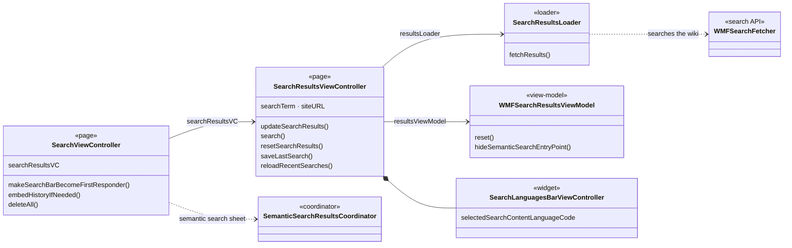
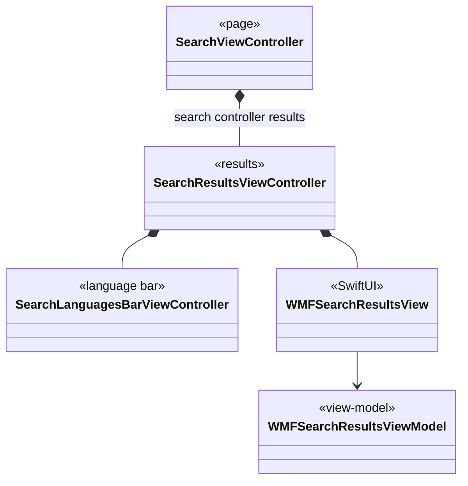
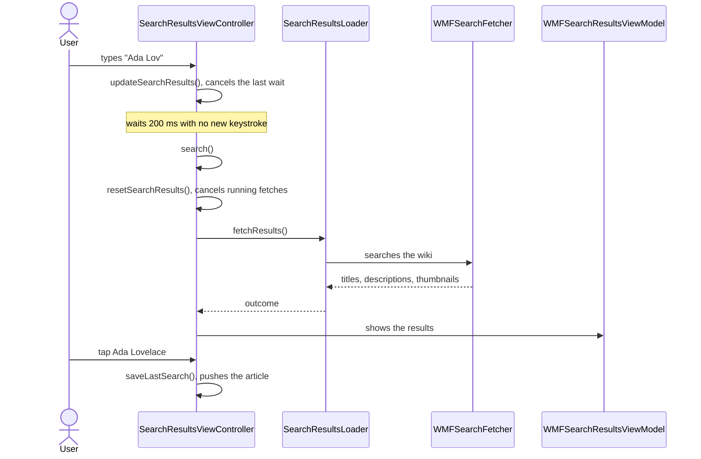

## What it does {#what}

`SearchViewController` is the root of the Search tab (the app can be set to open on it). Before you type it shows your reading history below the search bar, with a clear-all button. Focusing the bar presents a `UISearchController` whose results controller is `SearchResultsViewController`: with an empty field it lists recent search terms, and as soon as there is non-blank text it waits 200 ms after the last keystroke (cancelling the previous wait), then searches. A language bar above the results switches the search to another of your preferred wikis and searches again. `SearchResultsLoader` runs the query through `WMFSearchFetcher` against that wiki; a running search is cancelled whenever a new one starts. Results are rendered by the SwiftUI `WMFSearchResultsView`; tapping one saves the term to recent searches and pushes the article. For readers enrolled in the semantic-search experiment, an entry point under the results opens a sheet of passage matches, and the chosen article scrolls to the highlighted passage.

## Logic · class diagram {#classes}

The tab controller owns the UIKit search controller; the results controller does the searching and owns the SwiftUI model.

- `──▷` holds
- `◆──` contains
- `┄┄▷` uses

## Screen · view composition {#widgets}

- `◆──` contains
- `──▷` reads model

## Type a query · sequence {#sequence}

Each keystroke restarts a 200 ms wait; only the last one searches.

## Key files {#files}

- `Wikipedia/Code/SearchViewController.swift` · Search tab, history, semantic search
- `Wikipedia/Code/SearchResultsViewController.swift` · debounced search and recent searches
- `Wikipedia/Code/SearchResultsLoader.swift` · runs a search
- `Wikipedia/Code/WMFSearchFetcher.m` · search API calls
- `Wikipedia/Code/SearchLanguagesBarViewController.swift` · language switcher
- `WMFComponents/Sources/WMFComponents/Components/Search/` · SwiftUI results and recent searches
