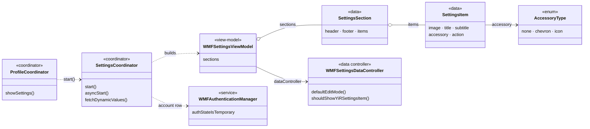
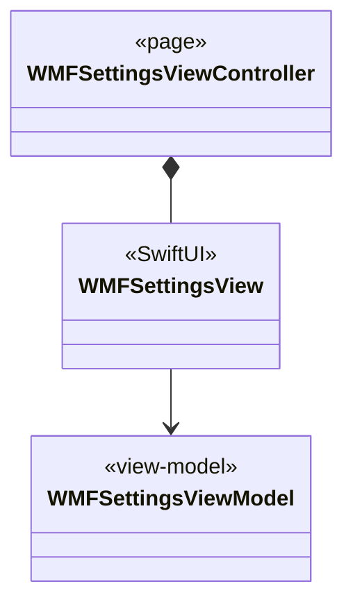
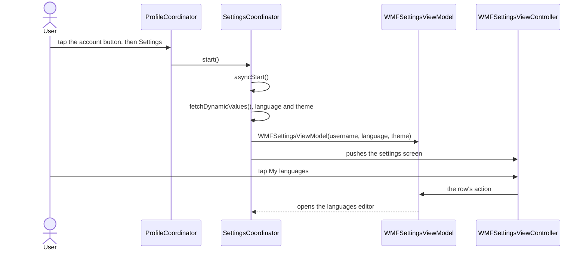

## What it does {#what}

Settings opens from the profile menu behind the account button in each tab's navigation bar: `ProfileCoordinator` starts `SettingsCoordinator`, which reads the current values (primary language, reading theme, account state) asynchronously and builds `WMFSettingsViewModel`, shown by `WMFSettingsViewController`. The first section is the account row — **Log in** when logged out, your username (or temporary-account name) otherwise. The main section has **My languages** (showing the primary one), **Search**, the Home feed settings (For You and Community, or the classic Explore settings), **Year in Review** when it is offered, **Push notifications**, **Reading preferences** (showing the current theme), **Article storage and syncing**, and **Clear cached data**, which asks first. Then come editing preferences (the default editor), donations (donation reminders, clear donation history), privacy (privacy policy, terms of use, safety, opening in the browser) and finally rate the app, help and about. Each row's action is a closure the coordinator supplies, so the SwiftUI view never knows where a row leads; values that change (language, theme) are re-read when the screen appears.

## Logic · class diagram {#classes}

The coordinator owns every navigation decision; the view model is just sections of rows with closures.

- `──▷` holds
- `◇──` list of
- `┄┄▷` uses

## Screen · view composition {#widgets}

- `◆──` contains
- `──▷` reads model

## Open Settings, change the languages · sequence {#sequence}

Settings is built asynchronously, because some row values come from async data.

## Key files {#files}

- `Wikipedia/Code/SettingsCoordinator.swift` · builds settings and handles every row
- `Wikipedia/Code/ProfileCoordinator.swift` · profile menu that opens settings
- `WMFComponents/Sources/WMFComponents/Components/Settings/` · settings view, view model and sub-screens
- `WMFData/Sources/WMFData/Data Controllers/Settings/` · stored settings
