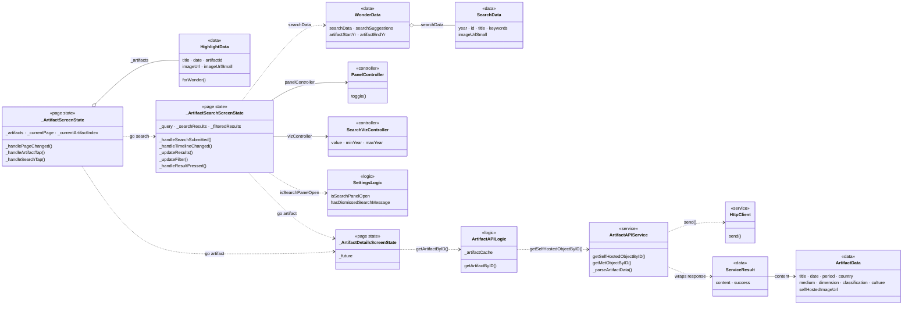
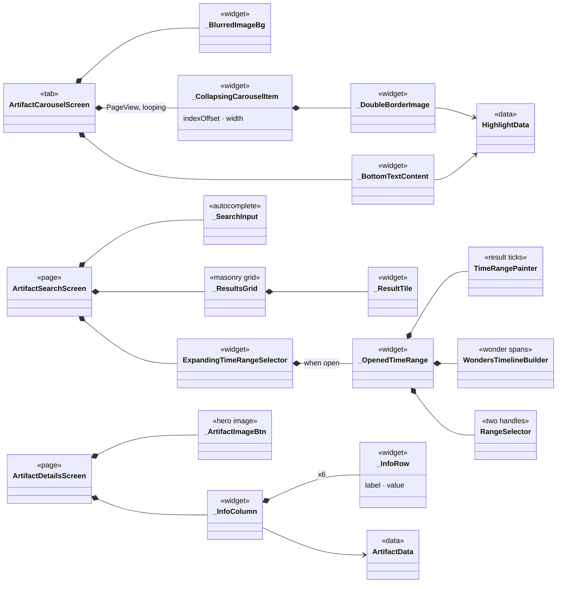
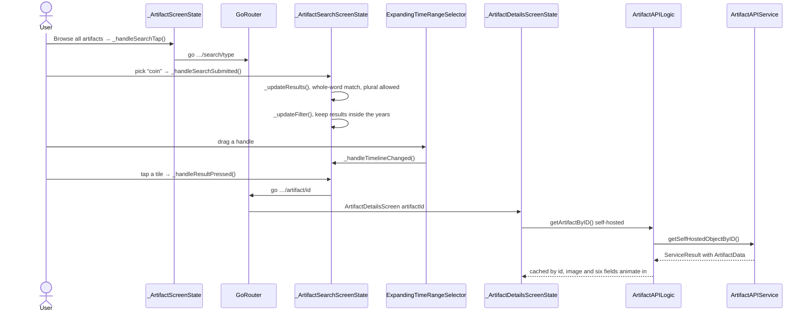

## What it does {#what}

The carousel shows the wonder’s highlight artifacts (6 per wonder, 5 for Christ the Redeemer — 47 Met Museum objects bundled in `HighlightData`) and loops. The centre item is a tall pill (1.5 × its width); neighbours shrink to circles and drop by 0.5 and 0.825 of the width, and items 3 or more away fade out. Item height is the screen height minus 200 minus the text area, clamped to 250–400 px, and the background is the current artifact blurred (sigma 6, no blur on Android) under a 60–80 % black veil. Tapping the centre opens `…/artifact/`; tapping a side item scrolls to it. “Browse all artifacts” and the search button open `…/search/`, which filters the wonder’s bundled `SearchData` (17 for Christ the Redeemer, 189–493 for the others, 2,686 in all): whole-word, case-insensitive matches on title or keywords, plural “s” allowed, with autocomplete from the wonder’s 11–103 suggestions (the first 10 when empty). A time-range panel, open or closed as last left (saved as `isSearchPanelOpen`), starts at the wonder’s artifact years, draws every result as a tick across −3000 to 2200 and filters the masonry grid (one column per 300 px). In Chinese a dismissible note says results are in English. Details load the object’s JSON from the wonderous.info mirror of the Met API through `ArtifactAPILogic`, which caches it by id; the image sits in an app bar that collapses from 50 % to 35 % of the screen (tap for a zoomable full-screen view) above six fields that slide in 100 ms apart after 600 ms.

## Logic · class diagram {#classes}

Highlights and search data ship inside the app; only the details page goes to the network, through a logic class that caches and a stateless service that parses.

- `──▷` holds
- `◇──` list of
- `┄┄▷` uses
- `──▷|` extends

## Screen · widget composition {#widgets}

Three screens: the carousel tab, the search page with its expanding time-range panel, and the details page with a collapsing image.

- `◆──` contains
- `──▷` reads model
- `┄┄▷` builds

## Search for an artifact and open it · sequence {#sequence}

Search is a local filter in two steps (query, then years); opening a result is the only network call.

## Key files {#files}

- `lib/ui/screens/artifact/artifact_carousel/` · highlights carousel
- `lib/ui/screens/artifact/artifact_search/artifact_search_screen.dart` · search, filter, controllers
- `lib/ui/screens/artifact/artifact_search/time_range_selector/` · year range panel
- `lib/ui/screens/artifact/artifact_details/` · details page
- `lib/logic/artifact_api_logic.dart` · cached artifact lookup
- `lib/logic/artifact_api_service.dart` · Met JSON → ArtifactData
- `lib/logic/common/http_client.dart` · GET, errors, ServiceResult
- `lib/logic/data/highlight_data.dart` · 47 highlight artifacts
- `lib/logic/data/wonders_data/search/` · bundled search data
