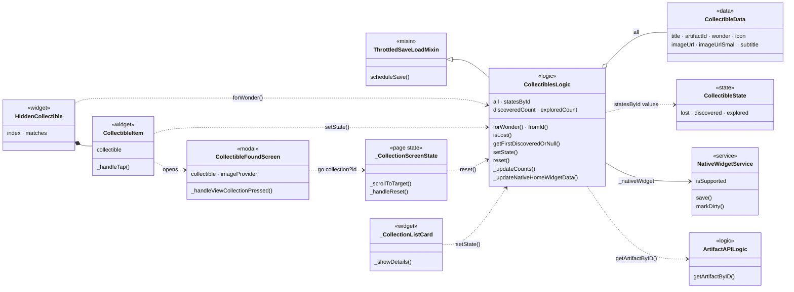
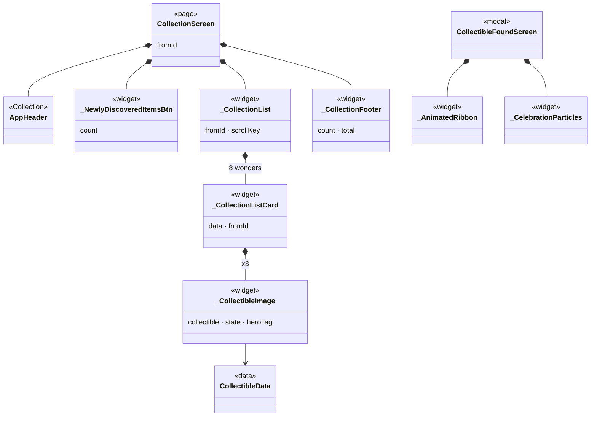
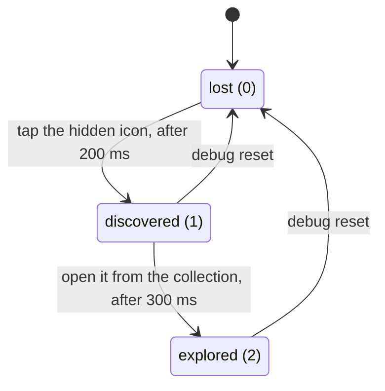
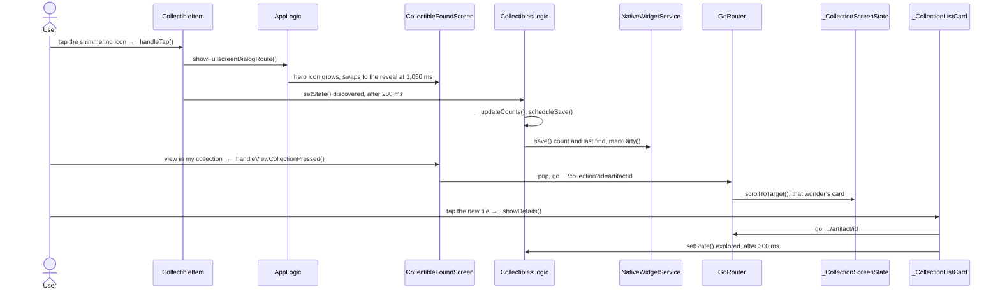

## What it does {#what}

`collectiblesData` holds 24 collectibles, 3 per wonder, each a Met Museum object with an icon. A wonder’s first is hidden in its editorial, the second in a corner cell of its photo grid and the third at the end of its events list. The icon shimmers, shakes and pulses on a loop; tapping it opens “Artifact Discovered” as a fade dialog — the icon flies in as a hero and grows from 1.5× to 3×, at 1,050 ms the screen swaps to the artifact image, a ribbon, its title and culture, with particles — and 200 ms later the collectible becomes discovered, so the hidden icon folds away. Each state is saved in `collectibles.dat` (at most every 2 s). On iOS every change also updates the home-screen widget: the found count and the last find’s title, date (fetched through `ArtifactAPILogic`) and image as base64. “view in my collection” opens `…/collection?id=` scrolled to that wonder. The collection lists the 8 wonders (300 px cards, or 600 px side by side in landscape) with three tiles each: dark silhouettes for lost, an orange border and glow for newly discovered. An “N new items” bar jumps to the first new one, and the footer shows the share found and “count of 24” with a bar that fills in 1.5 s. Opening a found item goes to its artifact page and marks it explored 300 ms later. A reset button (with confirmation) exists only in debug builds.

## Logic · class diagram {#classes}

CollectiblesLogic is the single source of truth: a ValueNotifier map of id → state that every hidden icon, the collection and the home-screen widget follow.

- `──▷` holds
- `◇──` list of
- `┄┄▷` uses
- `──▷|` extends

## Screen · widget composition {#widgets}

The collection is a header, a “new items” bar, a list of one card per wonder with three tiles each, and a progress footer.

- `◆──` contains
- `──▷` reads model
- `┄┄▷` builds

## A collectible’s life · state machine {#state}

Stored per id in CollectiblesLogic.statesById and saved to collectibles.dat; only a debug reset goes backwards.

## Find a hidden artifact and look at it · sequence {#sequence}

The celebration and the state change run side by side; everything else reacts to the new state.

## Key files {#files}

- `lib/logic/collectibles_logic.dart` · states, counts, widget data
- `lib/logic/data/collectible_data.dart` · 24 collectibles, states
- `lib/logic/native_widget_service.dart` · iOS home-screen widget
- `lib/ui/common/hidden_collectible.dart` · picks this wonder’s item
- `lib/ui/common/collectible_item.dart` · shimmering icon, tap
- `lib/ui/screens/collectible_found/` · discovery celebration
- `lib/ui/screens/collection/` · collection list and footer
