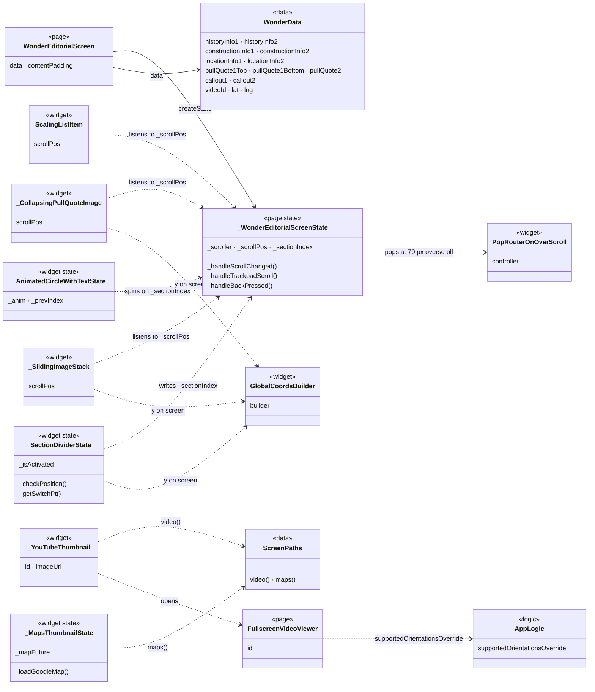
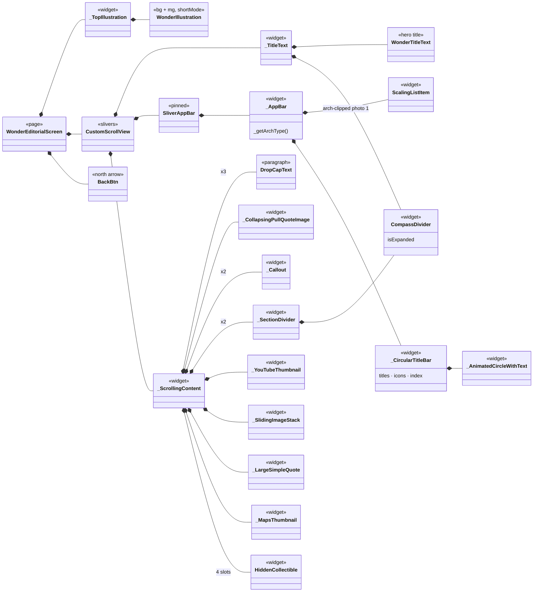
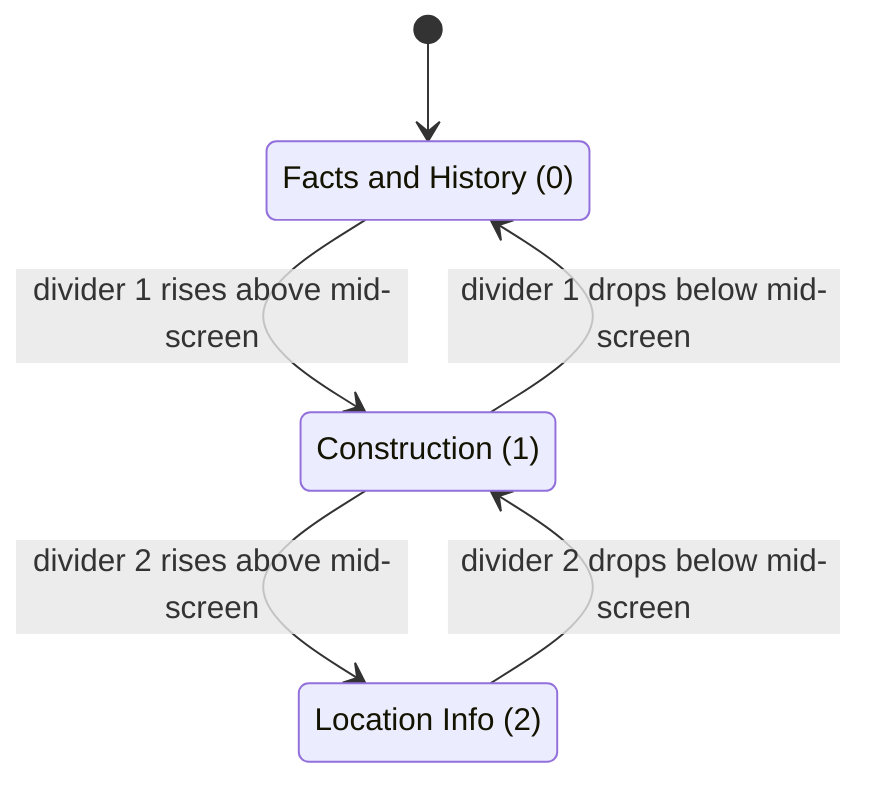
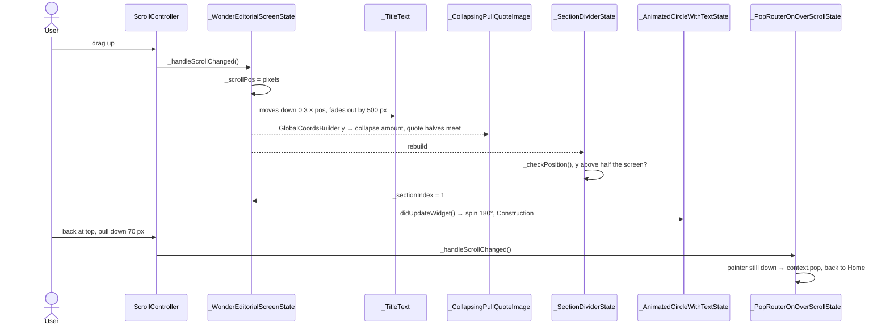

## What it does {#what}

A `CustomScrollView` slides over a fixed illustration of the wonder (150, 250 or 280 px tall for screens under 525, under 700 or taller) that shows through a transparent first sliver and fades out over the first 700 px of scroll. The title block — subtitle, hero title, region, a compass divider that folds away once you scroll, and the date range — drifts down at 30 % of the scroll speed and is gone after 500 px. A pinned app bar collapses from 1.2 × the screen width (width capped at 800 px) to 150 px (80 px on screens under 700 px tall); it shows photo 1 clipped to the wonder’s arch (pyramid, flat pyramid, arch, wide arch or spade), turning into a coloured band below 300 px, with a circular title that rolls 180° to “Facts and History”, “Construction” or “Location Info” as each section divider passes the middle of the screen. The article runs history → pull quote over photo 2 that collapses as it scrolls up → callout → construction → YouTube thumbnail (`…/video/`, full-screen player that unlocks landscape) → photos 3 and 4 sliding past each other → location → large quote → a Google map (zoom 3) that opens `…/maps/` as a full-screen hybrid map at zoom 17 (hidden on desktop). Paragraphs open with a drop cap in English only. Four slots can hold this wonder’s first hidden collectible; each wonder uses exactly one of them. Pulling 70 px past the top while dragging pops back to Home, and so does the north-arrow button, which hides once you scroll.

## Logic · class diagram {#classes}

One ScrollController feeds a ValueNotifier of the scroll position; every animated piece listens to it and measures its own place on screen, and the section dividers write the section index back.

- `──▷` holds
- `◇──` list of
- `┄┄▷` uses
- `──▷|` extends

## Screen · widget composition {#widgets}

Illustration underneath, then four slivers: a transparent gap, the title block, the pinned arch app bar and the article column.

- `◆──` contains
- `──▷` reads model
- `┄┄▷` builds

## Which section the title shows · state machine {#state}

The circular title is driven by the two section dividers crossing the middle of the screen; each change spins the circle 180° in 600 ms.

## Scroll down the story · sequence {#sequence}

A scroll tick becomes one notifier update; each listener measures itself and animates, and a divider crossing mid-screen flips the section.

## Key files {#files}

- `lib/ui/screens/editorial/editorial_screen.dart` · scroll view and notifiers
- `lib/ui/screens/editorial/widgets/_scrolling_content.dart` · article order, video, map
- `lib/ui/screens/editorial/widgets/_app_bar.dart` · arch-clipped pinned header
- `lib/ui/screens/editorial/widgets/_circular_title_bar.dart` · rolling section title
- `lib/ui/screens/editorial/widgets/_section_divider.dart` · sets the section index
- `lib/ui/screens/editorial/widgets/_collapsing_pull_quote_image.dart` · collapsing pull quote
- `lib/ui/common/global_coords_builder.dart` · widget’s on-screen position
- `lib/ui/common/pop_router_on_over_scroll.dart` · pull past top to leave
- `lib/ui/common/modals/fullscreen_video_viewer.dart` · YouTube player
- `lib/ui/common/modals/fullscreen_maps_viewer.dart` · full-screen Google map
