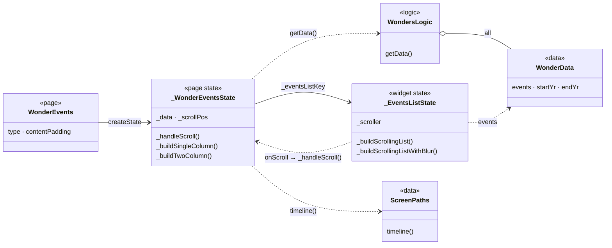
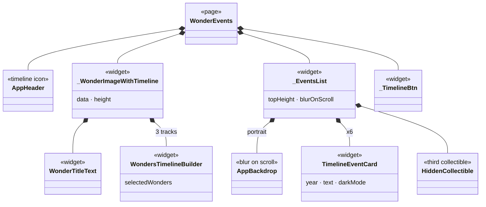
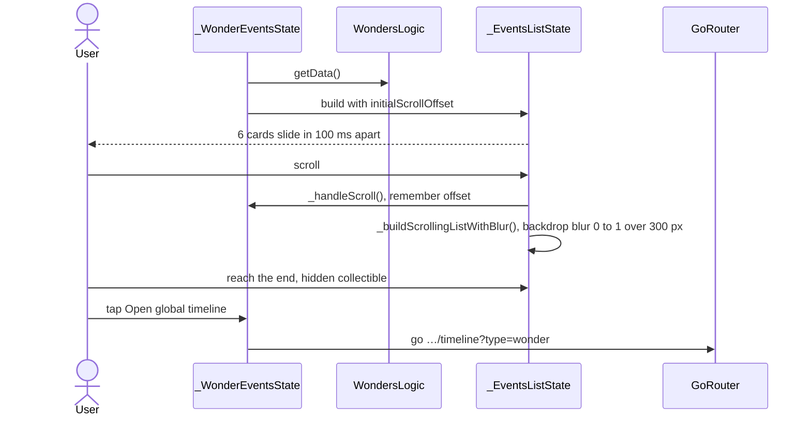

## What it does {#what}

Each wonder carries 6 events (`WonderData.events`, year → text). They appear as dark cards that fade in over 900 ms and slide up with a small overshoot, 100 ms apart. In portrait the list scrolls over the top 55 % of the screen (at least 200 px), which shows the wonder’s flattened image, its title, a mini timeline of all 8 wonders on 3 non-overlapping tracks with this one filled in, and its dates and era; the background blurs and darkens (up to 60 %) between 50 and 350 px of scroll. On wide screens — aspect ratio over 0.85 on phones, so foldables count, or over 1 elsewhere — the image and list sit side by side, and the scroll offset carries over when the layout switches. The third hidden collectible waits at the end of the list. “Open global timeline” (button and header icon) goes to `…/timeline?type=`.

## Logic · class diagram {#classes}

A read-only view over WonderData: the only state is the scroll offset, kept so the two layouts can hand it to each other.

- `──▷` holds
- `◇──` list of
- `┄┄▷` uses
- `──▷|` extends

## Screen · widget composition {#widgets}

Portrait stacks the list over the image-with-timeline; landscape puts them in a row.

- `◆──` contains
- `──▷` reads model
- `┄┄▷` builds

## Read the events and open the global timeline · sequence {#sequence}

Scrolling only changes blur and remembers the offset; the button hands over to the timeline route.

## Key files {#files}

- `lib/ui/screens/wonder_events/wonder_events.dart` · one or two columns
- `lib/ui/screens/wonder_events/widgets/_events_list.dart` · cards, blur on scroll
- `lib/ui/screens/wonder_events/widgets/_wonder_image_with_timeline.dart` · image, mini timeline, era
- `lib/ui/common/wonders_timeline_builder.dart` · wonders on 3 tracks
- `lib/ui/common/timeline_event_card.dart` · year + text card
