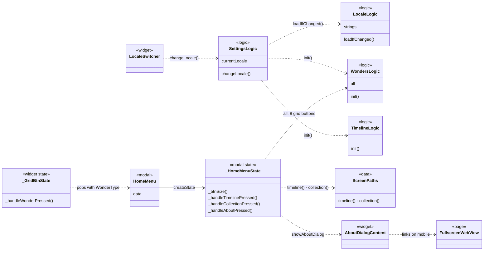
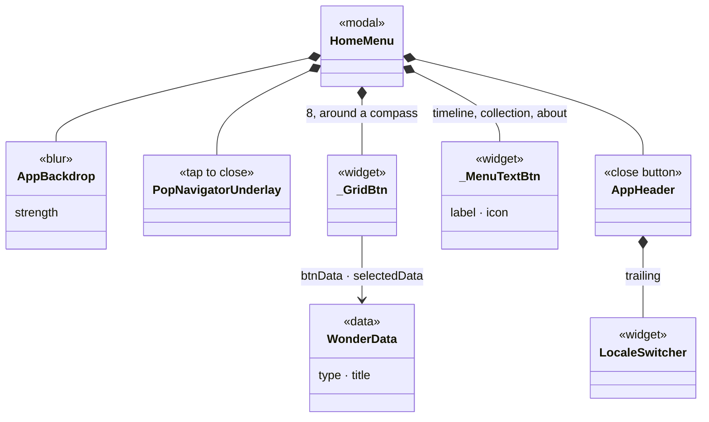
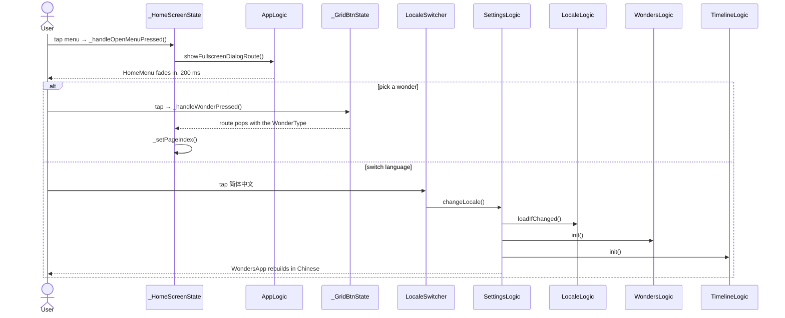

## What it does {#what}

A blurred, half-transparent backdrop over Home holds a 3 × 3 grid: the 8 wonder buttons around a compass, each `shortestSide / 5` clamped to 60–100 px, the current wonder with a 5 px border. Tapping one pops the dialog with its `WonderType` and Home jumps there; tapping outside closes it. Below are three links that fade and slide in 50 ms apart after 250 ms: “Explore the timeline” (`/home/timeline?type=` the current wonder), “View your collection” (`/home/collection`) and “About this app”, a Material about dialog with the version, “© 2022 gskinner” and links that open in a full-screen web view on phones or the browser on desktop and web. The top-right button swaps English ↔ 简体中文: it saves `currentLocale`, reloads the strings, and re-runs `WondersLogic.init()` and `TimelineLogic.init()` because the wonder and event data hold translated text; `WondersApp` watches the locale and rebuilds.

## Logic · class diagram {#classes}

The menu is a dialog that returns a value: Home awaits the pushed route, and a language switch fans out through SettingsLogic to every logic class holding translated text.

- `──▷` holds
- `◇──` list of
- `┄┄▷` uses
- `──▷|` extends

## Screen · widget composition {#widgets}

Backdrop, an invisible tap-to-close underlay, then a centred column of the wonder grid and three text buttons, with the close and language buttons in the header.

- `◆──` contains
- `──▷` reads model
- `┄┄▷` builds

## Jump to a wonder, or switch language · sequence {#sequence}

The menu is awaited like a function call; the language switch never leaves the menu.

## Key files {#files}

- `lib/ui/screens/home_menu/home_menu.dart` · grid and menu links
- `lib/ui/screens/home_menu/about_dialog_content.dart` · About text and links
- `lib/ui/common/controls/locale_switcher.dart` · en ↔ zh button
- `lib/logic/settings_logic.dart` · changeLocale() fan-out
- `lib/ui/common/utils/page_routes.dart` · fade dialog route
