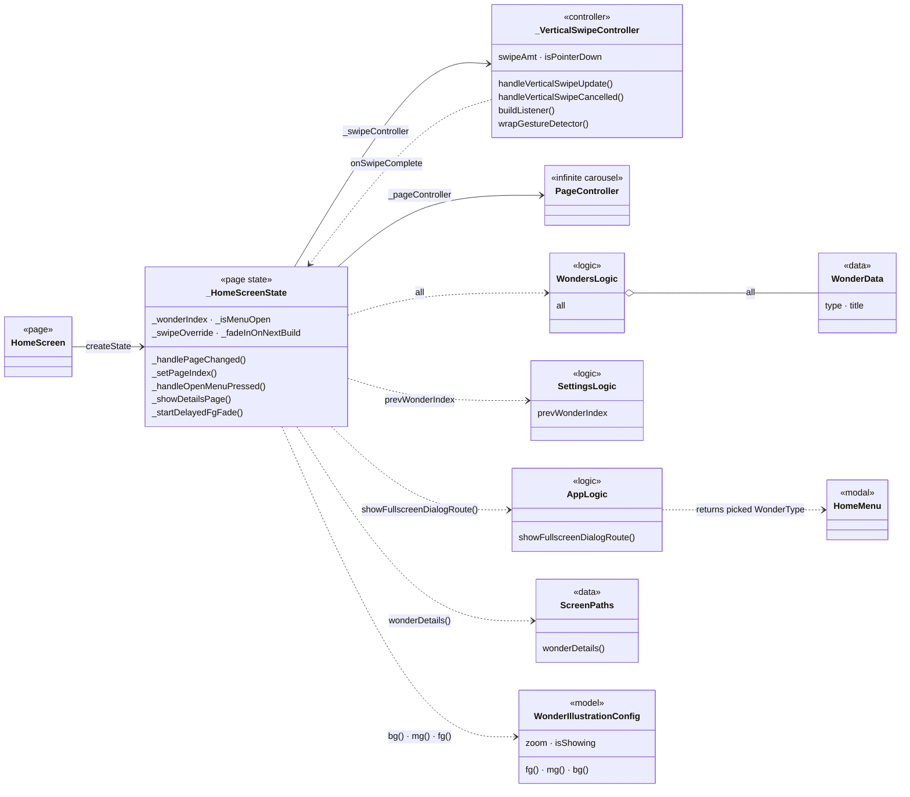
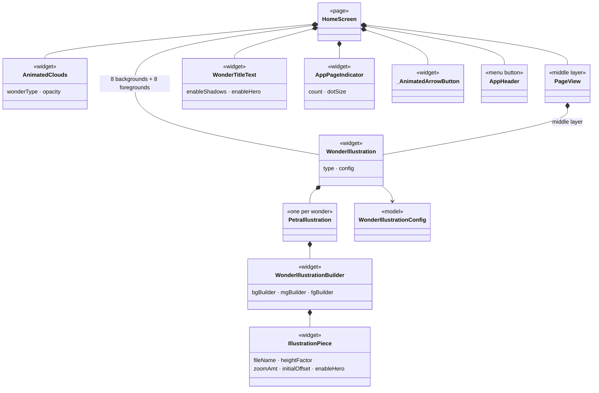
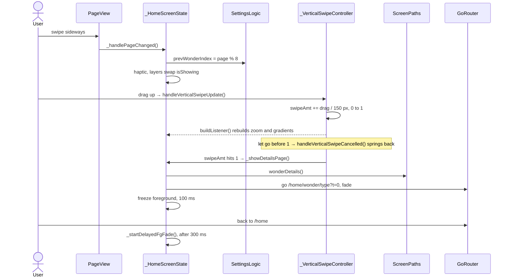

## What it does {#what}

Each wonder is drawn in three layers — a background (sky colour, texture, sun or moon), a middle illustration in a `PageView`, and foreground pieces at the edges — plus clouds seeded per wonder that drift in over 1.5 s. The carousel starts at page 8 × 100 + the last wonder viewed (saved as `prevWonderIndex`), so it loops both ways; changing wonder gives a light haptic and each layer animates its pieces in or out over 450 ms. Pulling up 150 px opens the wonder: while you drag, every piece scales by its own `zoomAmt` × the pull (× 0.4 for the foreground, × 0.05 for the middle) and the bottom gradient darkens; letting go early springs back over half a second per full pull. Opening goes to `/home/wonder/?t=0` with a fade while the foreground is frozen in place, and on return the foreground fades back in after 300 ms. The arrow button and a trackpad scroll up open it too; the 8 px page dots and desktop arrow keys jump between wonders. The menu button opens `HomeMenu` as a 200 ms fade dialog and jumps to whichever wonder is picked there.

## Logic · class diagram {#classes}

The screen state owns an infinite PageController and a small swipe controller; both just feed numbers into the shared illustration widgets.

- `──▷` holds
- `◇──` list of
- `┄┄▷` uses
- `──▷|` extends

## Screen · widget composition {#widgets}

A Stack of four layers — 8 backgrounds, the middle PageView, 8 foregrounds, floating UI — where only the selected wonder’s layers are showing.

- `◆──` contains
- `──▷` reads model
- `┄┄▷` builds

## Pick a wonder and swipe up into it · sequence {#sequence}

Sideways paging is a plain PageView; the upward pull is a hand-rolled gesture that ends in a route change.

## Key files {#files}

- `lib/ui/screens/home/wonders_home_screen.dart` · carousel and layer stack
- `lib/ui/screens/home/_vertical_swipe_controller.dart` · swipe-up gesture
- `lib/ui/wonder_illustrations/` · eight layered illustrations
- `lib/ui/wonder_illustrations/common/wonder_illustration_builder.dart` · bg/mg/fg layer animation
- `lib/ui/wonder_illustrations/common/illustration_piece.dart` · one positioned image piece
- `lib/ui/wonder_illustrations/common/animated_clouds.dart` · seeded drifting clouds
- `lib/logic/wonders_logic.dart` · the 8 WonderData
- `lib/logic/data/wonders_data/` · per-wonder text and numbers
