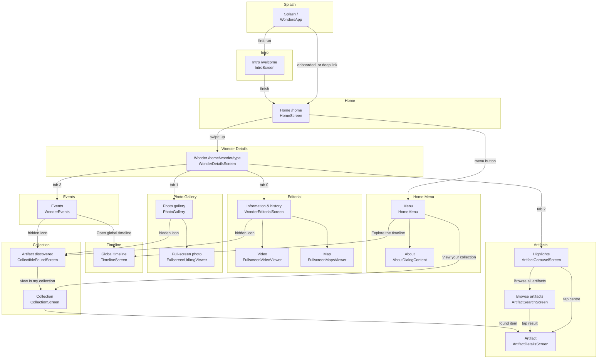
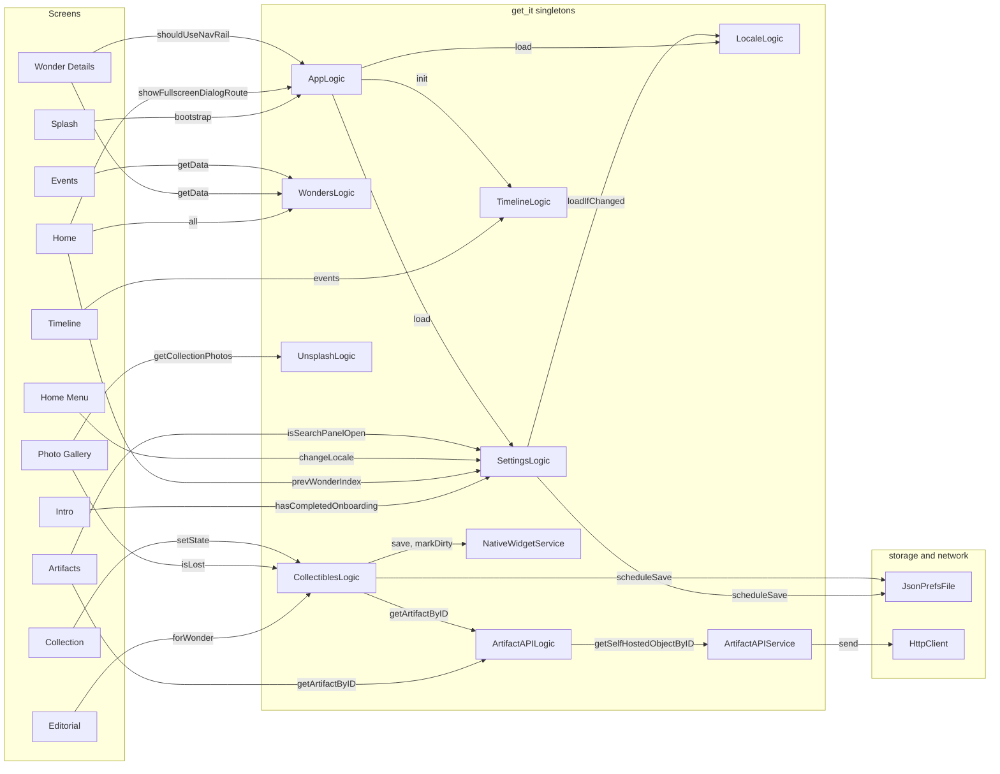

## Screens · how the user moves

Every screen is a GoRouter path under one ShellRoute: the app boots on a hidden `/`, goes to `/welcome` once and then lives under `/home`. A wonder opens at `/home/wonder/?t=`, and search, artifact, video, map, timeline and collection pages are appended to the current path, so back always returns where you came from.

- `───▷` opens
- `▭` tap to open its module

## Services · what the screens talk through

The logic layer is a set of plain classes registered as lazy singletons in get_it and reached through top-level getters (`wondersLogic`, `settingsLogic`…). Content ships with the app; only artifact details (and their images) come from the network, and only settings and collectibles are saved.

- `───▷` calls, labelled with the method
- `▭` tap to open its module
