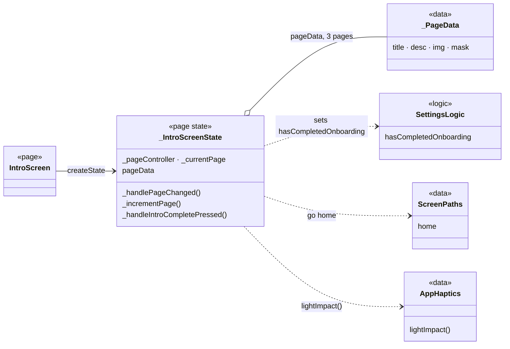
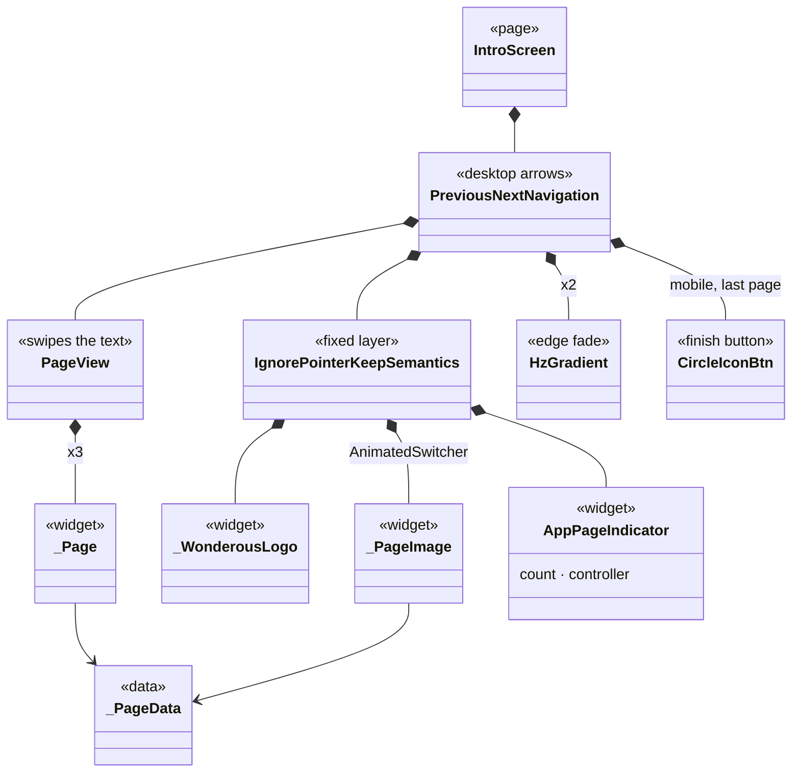
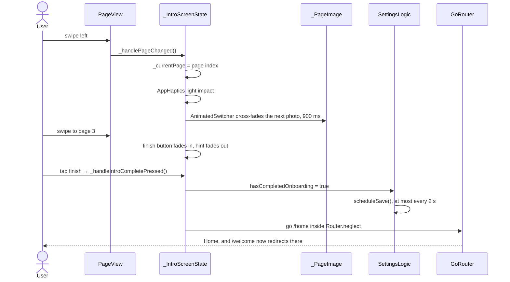

## What it does {#what}

Three pages — “Journey to the past”, “Explore places”, “Discover artifacts” — each pair a title and a line of text with a photo (camel, Petra, statue) cut out by its own mask image. Only the text actually swipes: a full-screen `PageView` carries the titles, and the logo, the 250 px image (150 px when the screen is under 550 px tall) and the page dots sit in a fixed layer on top, lined up with gaps in each page. The image cross-fades in 900 ms when the page changes, each swipe gives a light haptic tap, and the whole screen fades in after 500 ms. On the last page the “Swipe left to continue” hint fades out and an orange finish button fades in (300 ms); pressing it sets `hasCompletedOnboarding` (saved to `settings.dat`) and goes to `/home` inside `Router.neglect`, so `/welcome` never comes back — the router also redirects it to home from then on. On desktop and web, `PreviousNextNavigation` adds arrow buttons and arrow-key paging (max width 600).

## Logic · class diagram {#classes}

All state is local to the screen: a PageController drives a page-index notifier, and the only thing that leaves the screen is the onboarding flag.

- `──▷` holds
- `◇──` list of
- `┄┄▷` uses
- `──▷|` extends

## Screen · widget composition {#widgets}

Two layers in one Stack: a swipeable PageView of text pages, and a fixed column of logo, masked image and dots that ignores touches.

- `◆──` contains
- `──▷` reads model
- `┄┄▷` builds

## Swipe through and enter the app · sequence {#sequence}

Paging only moves the text; the fixed layer listens to the page index and swaps the image.

## Key files {#files}

- `lib/ui/screens/intro/intro_screen.dart` · pages, logo, masked image
- `lib/ui/common/previous_next_navigation.dart` · desktop arrows and keys
- `lib/ui/common/controls/app_page_indicator.dart` · page dots
- `lib/logic/settings_logic.dart` · hasCompletedOnboarding flag
