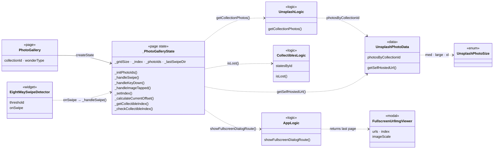
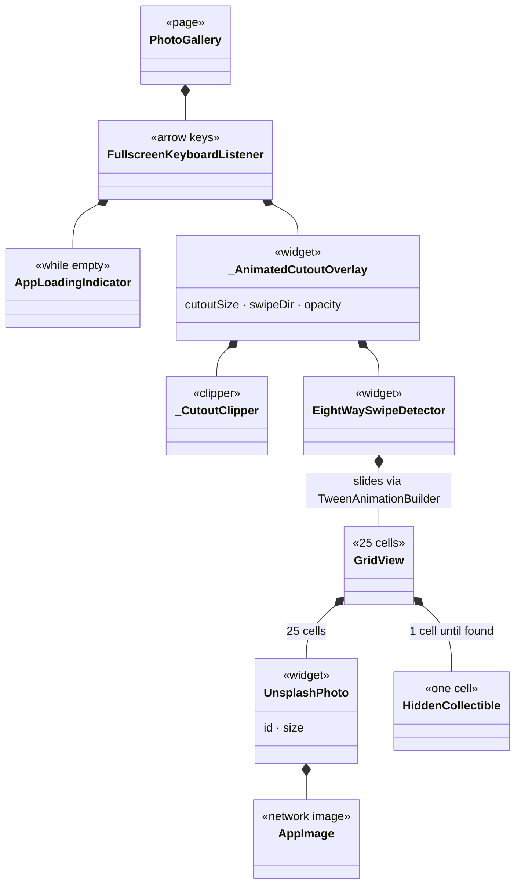
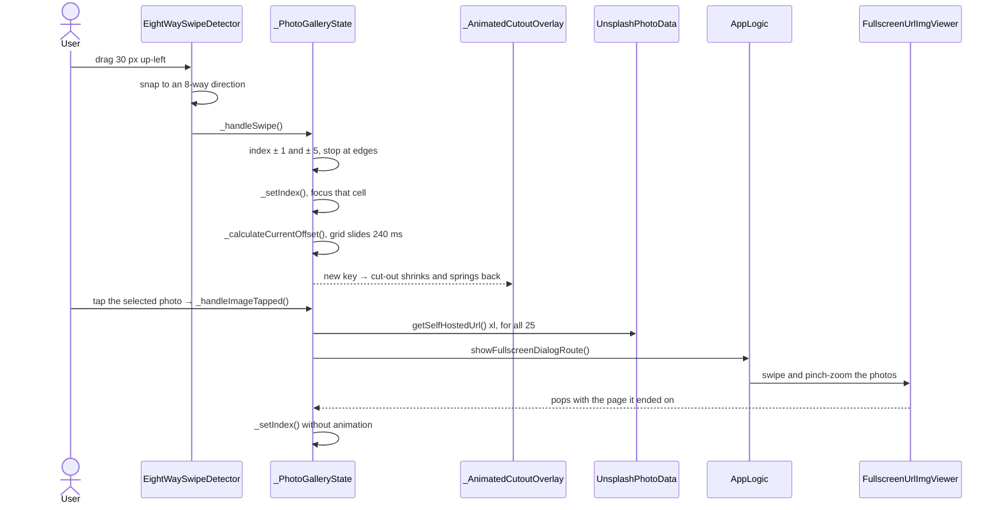

## What it does {#what}

The wonder’s Unsplash collection id picks one of 8 bundled lists of 24 photo ids (`UnsplashPhotoData.photosByCollectionId`); the list is repeated and cut to fill 25 cells, and each photo loads from wonderous.info at 400, 800 or 1200 px (doubled on 1.5× screens and desktop) — the live Unsplash API in `UnsplashService` is only used by dev tools. The grid starts on index 13 (12.5 rounds up, one cell right of centre). A swipe of 30 px in any of 8 directions or an arrow key moves one cell or row (never past an edge), and tapping a visible neighbour selects it; the whole grid slides there in 240 ms while the selected photo scales to 1.15 and a 70 % black overlay keeps a rounded cut-out around it that briefly shrinks 25 % along the swipe axis. Tapping the selected photo opens `FullscreenUrlImgViewer` with all 25 at 1200 px (pinch to zoom, swipe between them); closing it returns the page you ended on and the grid jumps there without animating. One corner cell, chosen per wonder, hides the wonder’s second collectible until it is found.

## Logic · class diagram {#classes}

Everything is index arithmetic on a fixed grid: swipes, keys and taps become a new index, and the offset that centres it is computed, not scrolled.

- `──▷` holds
- `◇──` list of
- `┄┄▷` uses
- `──▷|` extends

## Screen · widget composition {#widgets}

A grid bigger than the screen, translated so the selected cell sits in the middle, under a black overlay with a cut-out.

- `◆──` contains
- `──▷` reads model
- `┄┄▷` builds

## Swipe across the wall and open a photo · sequence {#sequence}

A swipe is snapped to one of 8 directions, turned into an index, and the grid animates to that index’s offset.

## Key files {#files}

- `lib/ui/screens/photo_gallery/photo_gallery.dart` · grid, index math, taps
- `lib/ui/screens/photo_gallery/widgets/_animated_cutout_overlay.dart` · overlay with cut-out
- `lib/ui/common/controls/eight_way_swipe_detector.dart` · 8-direction swipes
- `lib/ui/common/modals/fullscreen_url_img_viewer.dart` · full-screen photo pager
- `lib/logic/unsplash_logic.dart` · photo ids per collection
- `lib/logic/data/unsplash_photo_data.dart` · bundled ids, image URLs
