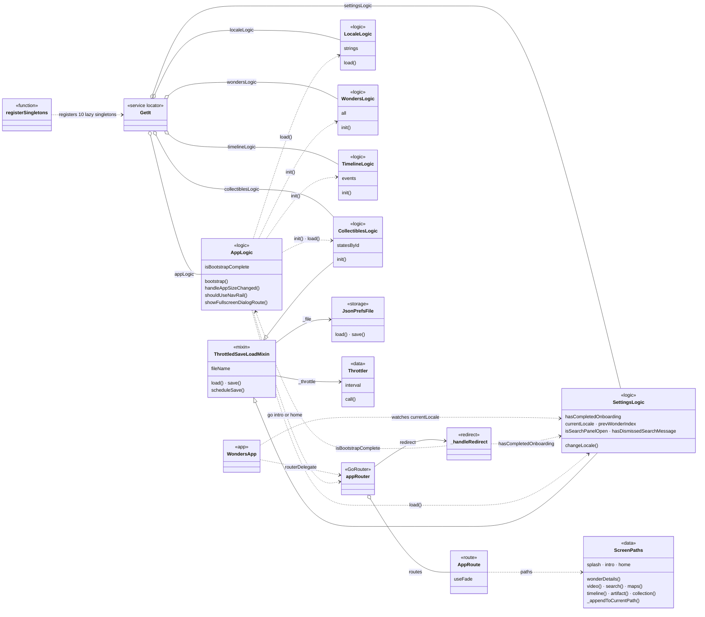
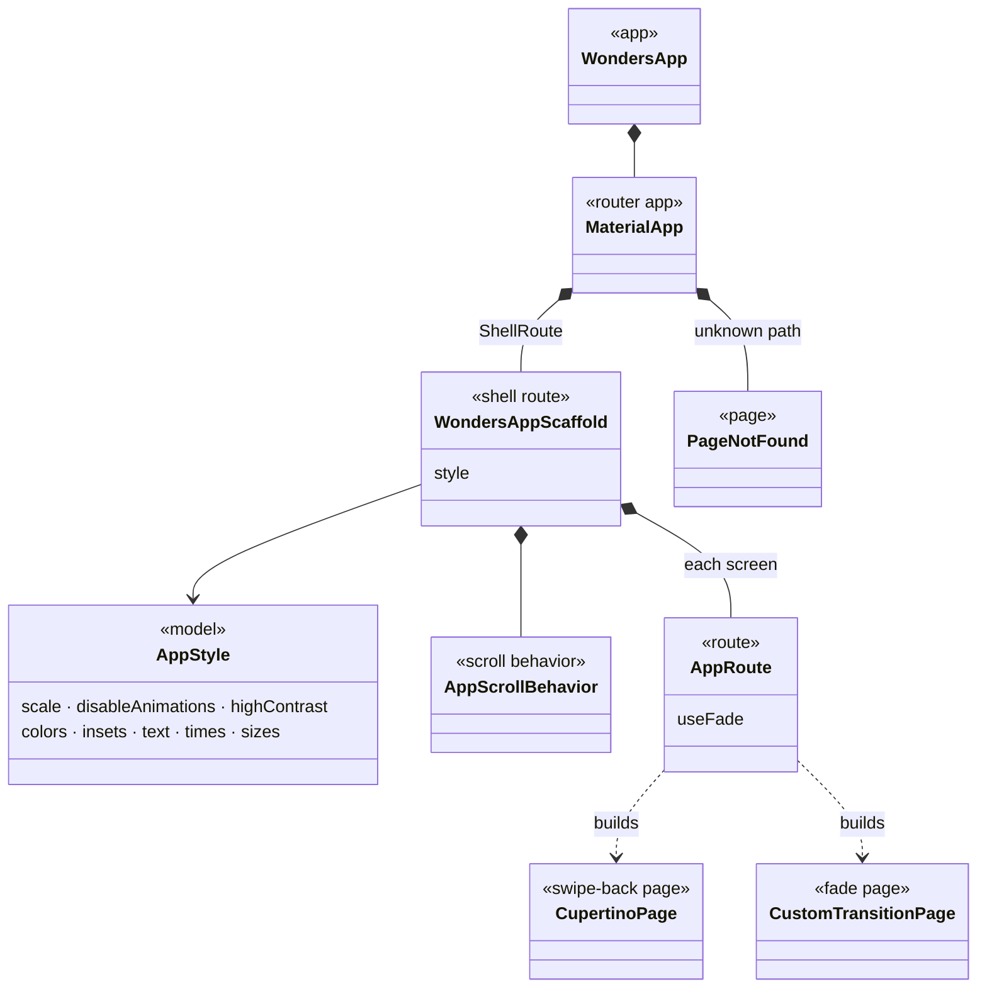
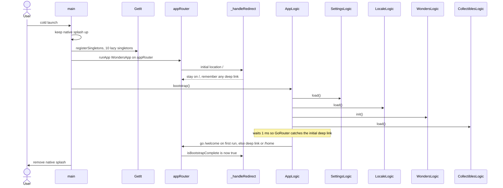

## What it does {#what}

`main()` keeps the native splash on screen (`FlutterNativeSplash.preserve`), registers 10 lazy singletons with get_it (8 logic classes plus `ArtifactAPIService` and `NativeWidgetService`) and starts `WondersApp`, a `MaterialApp.router` on the global `appRouter` whose locale follows `SettingsLogic.currentLocale`. Views reach logic through 8 top-level getters (`appLogic`, `wondersLogic`, `settingsLogic`…); services deliberately get no shortcut. `bootstrap()` then sets a 380×650 minimum window on desktop, loads the map-marker bitmap, asks Android for its highest refresh rate, loads settings and strings, builds the 8 wonders, the timeline events and the collectibles, waits 1 ms so GoRouter can catch a deep link, flips `isBootstrapComplete` and goes to `/welcome` on first run, otherwise to the saved deep link or `/home` (inside `Router.neglect`, so `/` never becomes a back target). Until then `_handleRedirect` sends every path to `/` and remembers the first as the deep link; afterwards it sends `/`, and `/welcome` once onboarding is done, to `/home`. Settings and collectibles are JSON strings in SharedPreferences (`settings.dat`, `collectibles.dat`), saved at most once every 2 s by `Throttler`. Every screen is an `AppRoute`: a Cupertino page (swipe back) or a fade when `useFade` is set or animations are off, and `ScreenPaths` appends nested pages (video, search, maps, timeline, artifact, collection) to the current path so back returns where you came from.

## Logic · class diagram {#classes}

One composition root: get_it owns every logic singleton, AppLogic runs them in order at boot, and the router reads two of their flags to decide where the app may go.

- `──▷` holds
- `◇──` list of
- `┄┄▷` uses
- `──▷|` extends

## Screen · widget composition {#widgets}

A ShellRoute wraps every screen in WondersAppScaffold, which rebuilds the shared AppStyle from the screen size; each route then picks a swipe-back or a fade page.

- `◆──` contains
- `──▷` reads model
- `┄┄▷` builds

## Launch the app · sequence {#sequence}

Cold start: the native splash stays up until bootstrap finishes, then the router replaces the empty / route.

## Key files {#files}

- `lib/main.dart` · get_it registration, WondersApp
- `lib/router.dart` · ScreenPaths, routes, redirect
- `lib/logic/app_logic.dart` · bootstrap and orientation
- `lib/logic/settings_logic.dart` · five saved settings
- `lib/logic/locale_logic.dart` · loads en / zh strings
- `lib/logic/common/save_load_mixin.dart` · throttled JSON persistence
- `lib/logic/common/json_prefs_file.dart` · SharedPreferences JSON file
- `lib/ui/app_scaffold.dart` · shell, AppStyle per size
- `lib/styles/styles.dart` · AppStyle tokens and timings
