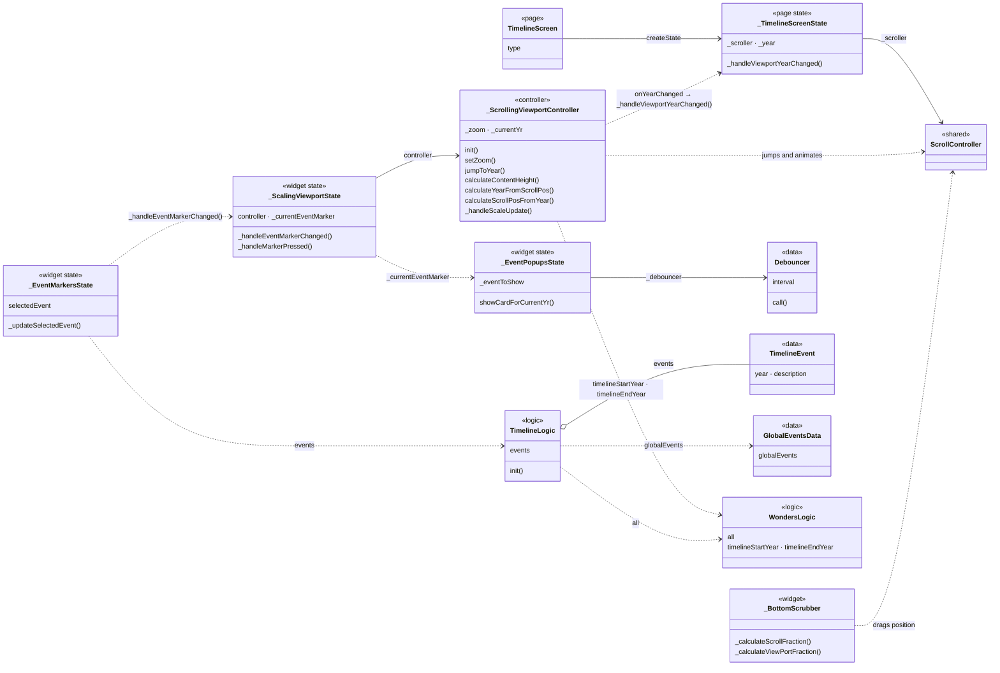
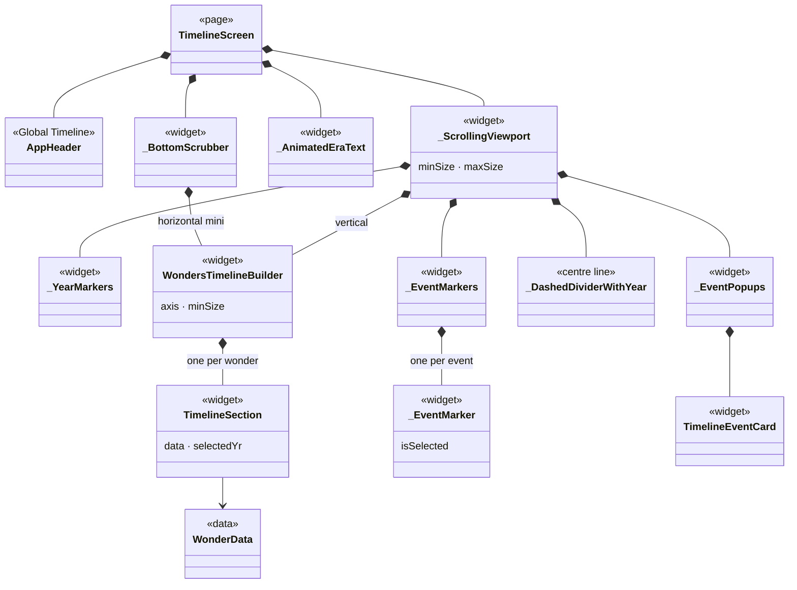
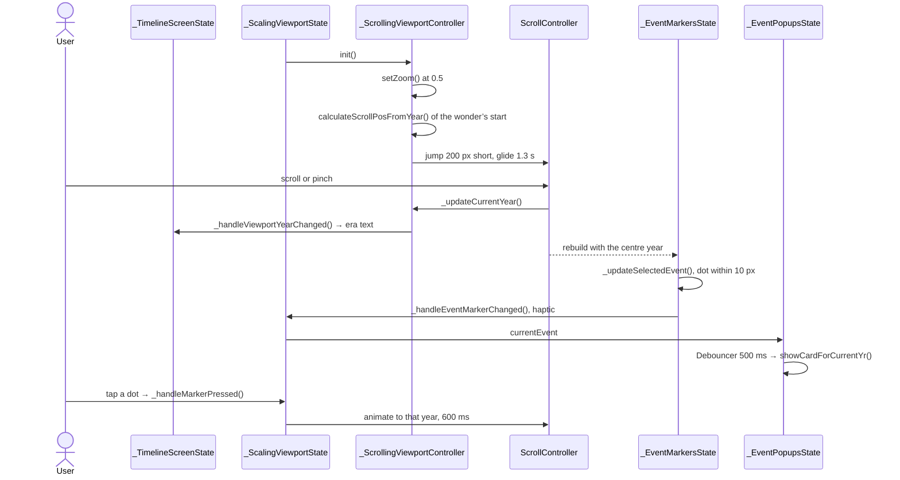

## What it does {#what}

Opened from the menu or a wonder’s events tab with `?type=`, it scrolls a vertical timeline of 5,200 years (`WondersLogic.timelineStartYear` −3000 to `timelineEndYear` 2200). The content height runs from 1,200 px minus half the viewport to 5,500 px with zoom (0–1, starting at 0.5); pinching (Ctrl + wheel on desktop) zooms while keeping the current year in place, and so does resizing the window. Year markers step every 500, 250 or 100 years as the content grows past 800 and 1,500 px. The 8 wonders sit on 3 non-overlapping tracks, each at least 100 px long, and each one’s image slides along its span as the centre year passes it; wonders other than the chosen one are greyed. A dashed centre line shows the year, the era below it changes at −600, 476 and 1450 (Prehistory, Classical, Early Modern, Modern), and on open the view jumps 200 px short of the wonder’s start year and glides there in 1.3 s. `TimelineLogic.events` holds 43 global events plus one “construction begins” event per wonder; the dot within 10 px of the centre line grows from 2 to 6 px with a haptic tick, and its card pops in after a 500 ms debounce. Tapping a dot scrolls to it. The 80 px scrubber at the bottom shares the same `ScrollController`: its box shows the visible part and dragging it scrolls the main view.

## Logic · class diagram {#classes}

A shared ScrollController is the timeline’s only clock: a small controller turns pixels into years and back, and the markers, era text and scrubber all read from it.

- `──▷` holds
- `◇──` list of
- `┄┄▷` uses
- `──▷|` extends

## Screen · widget composition {#widgets}

Header, the zoomable viewport (year markers, wonder tracks, event dots, centre line, popup), the era label and the mini scrubber.

- `◆──` contains
- `──▷` reads model
- `┄┄▷` builds

## Open the timeline at a wonder and browse events · sequence {#sequence}

Every change of scroll position is turned back into a year, and everything else follows from that year.

## Key files {#files}

- `lib/ui/screens/timeline/timeline_screen.dart` · layout, shared scroller
- `lib/ui/screens/timeline/widgets/_scrolling_viewport.dart` · zoomable timeline
- `lib/ui/screens/timeline/widgets/_scrolling_viewport_controller.dart` · years ↔ pixels, zoom
- `lib/ui/screens/timeline/widgets/_event_markers.dart` · event dots, selection
- `lib/ui/screens/timeline/widgets/_event_popups.dart` · debounced event card
- `lib/ui/screens/timeline/widgets/_bottom_scrubber.dart` · mini timeline scrubber
- `lib/logic/timeline_logic.dart` · global + wonder events
- `lib/logic/data/timeline_data.dart` · 43 global events
