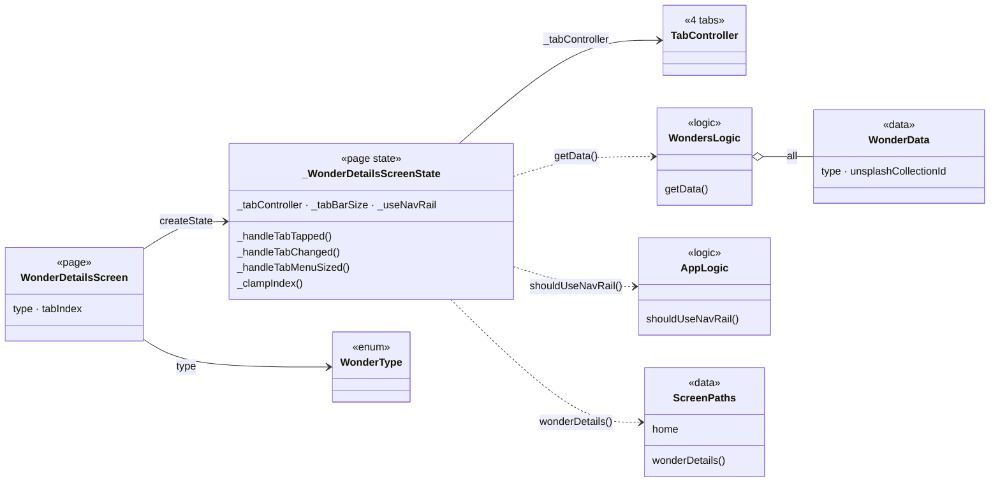
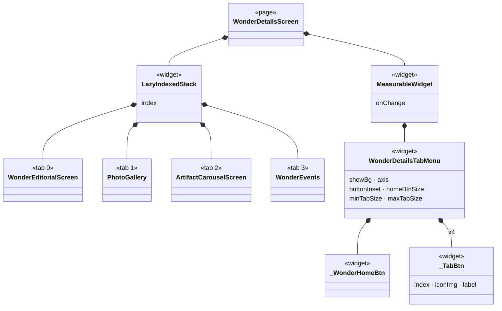
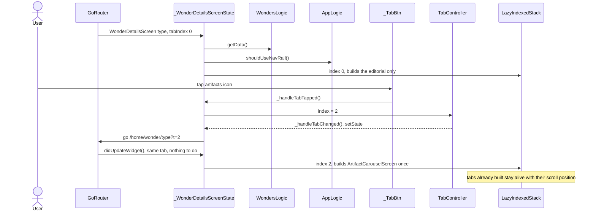

## What it does {#what}

The route fades in and hosts four full-screen tabs: “information and history” ([Editorial](editorial.html)), “photo gallery”, “artifacts” and “events”. The tab index comes from `?t=`, clamped to 0–3, and tapping a tab writes it back with `context.go`, so back, deep links and the web URL all land on the right tab. `LazyIndexedStack` builds a tab the first time it is shown and keeps it alive afterwards, so each tab keeps its scroll position. The bar has a 74 px round wonder button that returns home and four icon buttons sized (available length − 74 − 24) / 4, clamped to 25–100 px. Its white background fades out on the photo tab, where the icons turn white. When the window is wider than tall (and taller than 250 px) the bar becomes a vertical rail on the left. The bar measures itself and passes its size minus a 12 px inset to the tabs as `contentPadding`, so their content stops above it.

## Logic · class diagram {#classes}

The shell keeps a TabController and the URL in step, and decides between a bottom bar and a side rail from the window shape.

- `──▷` holds
- `◇──` list of
- `┄┄▷` uses
- `──▷|` extends

## Screen · widget composition {#widgets}

A Stack: the four tab screens in a lazy IndexedStack, with the measured tab menu aligned to the bottom or the left.

- `◆──` contains
- `──▷` reads model
- `┄┄▷` builds

## Open a wonder and switch tabs · sequence {#sequence}

The URL is the source of truth for the tab; the stack only builds what has been visited.

## Key files {#files}

- `lib/ui/screens/wonder_details/wonders_details_screen.dart` · tab host, URL sync
- `lib/ui/screens/wonder_details/wonder_details_tab_menu.dart` · bar or rail, buttons
- `lib/ui/common/lazy_indexed_stack.dart` · build on first visit
- `lib/ui/common/measurable_widget.dart` · reports the bar size
- `lib/router.dart` · wonder route and sub-routes
